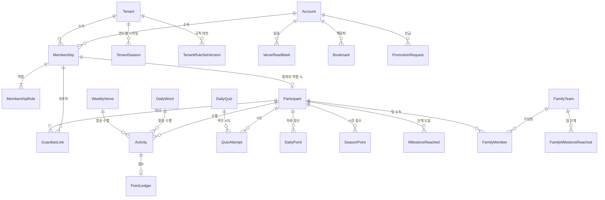

# 논리 설계 (초안)

- 상태: 초안 (2026-10-22)
- 기준: [도메인 모델](도메인-모델.md), ADR 0001 ~ 0033, 05 문서 X-01 ~ X-05 · X-18 ~ X-19
- 다음 단계: 물리 설계(DDL, 인덱스, RLS 정책, 마이그레이션)
- 자료형은 논리 수준이다(정수 · 문자열 · 날짜 · UTC 시각 · 참거짓 · JSON). 실제 SQL 형식은 물리 설계에서 정한다.

## 1. 공통 규칙

### 1-1. 키
- 모든 표는 **정수 대리키 `Id`** 를 쓴다. 아이디 · 이름 · 영역 코드 같은 업무 값은 키로 쓰지 않는다(X-01).
- 사람을 가리키는 키는 두 개뿐이다: 플랫폼 · 계정 범위는 `AccountId`, 영역 안 점수 · 기록은 `ParticipantId`.

### 1-2. 테넌트 키 규칙 (영역 범위 표)
| # | 규칙 |
|---|---|
| T-1 | 영역 범위 표는 모두 `TenantId` (NOT NULL)를 가진다. |
| T-2 | 영역 범위 표는 `(TenantId, Id)` 고유를 가진다. |
| T-3 | 영역 범위 표끼리의 참조는 **`(TenantId, 참조Id)` 복합 외래 키**로 건다. → 다른 영역 행을 가리키는 것을 DB 가 막는다. |
| T-4 | 영역 범위 표의 고유 제약 · 주요 인덱스는 **`TenantId` 를 맨 앞**에 둔다. |
| T-5 | 플랫폼 범위 표(계정 · 영역 · 성경)로의 참조는 단일 외래 키로 건다. |
| T-6 | 격리 조건은 RLS + 앱 전역 필터 둘 다(0020). 조건은 표의 범위에 따라 2절 표대로. |

### 1-3. 날짜 · 시각
- `…Utc` 는 UTC 시각, `…Date` 는 날짜만(영역 시간대 기준 날짜, R-02).
- 현재 시각 · 기본값을 DB 함수로 채우지 않는다. 모든 시각은 앱이 넣는다(X-09).

### 1-4. 값의 표현
- 예/아니오는 참거짓, 상태 · 종류는 짧은 코드 문자열(예: `Pending`, `Approved`). 'y'/'n' 같은 문자열 금지(X-05).
- 삭제: 콘텐츠는 기록이 가리키면 지우지 않고 보관 상태로 둔다(R-124). 업무 기록의 실제 삭제는 진급(6절)뿐이다.

## 2. 표 목록과 범위

| 범위 | 격리 조건 | 표 |
|---|---|---|
| 플랫폼 | 읽기 공유, 쓰기는 플랫폼 관리자 | Account, Tenant, BibleTranslation, BibleBook, BibleVerse, QuizBankItem, QuizBankChoice, PlatformRuleSetVersion, AuditLog |
| 플랫폼 + 영역 | `TenantId IS NULL`(공용) 또는 `TenantId = 현재 영역`. 쓰기는 각자 소유 행만 | 콘텐츠 4종과 하위 표 |
| 영역 | `TenantId = 현재 영역` | Membership, MembershipRole, Participant, GuardianLink, TenantRuleSetVersion, TenantSeason, Activity, QuizAttempt, PointLedger, DailyPoint, SeasonPoint, MilestoneReached, FamilyTeam, FamilyMember, FamilyMilestoneReached, FamilyMilestoneDismiss, Outbox |
| 계정 | `AccountId = 로그인 계정` (0029) | VerseReadMark, Bookmark, ReadingRound, ChapterRead(영역 관리자 요약 열람 — 4-7) |
| 예외 | 현재 영역이 Source 또는 Target (0030) | PromotionRequest |

## 3. 관계도 (주요 표)

## 4. 표 정의

> 표기: **PK** 기본 키, **UK** 고유, **FK** 외래 키, **CK** 검사 조건. 영역 범위 표의 `(TenantId, Id)` 고유(T-2)는 따로 적지 않는다.

### 4-1. 테넌시

**Account** — 플랫폼
| 열 | 형 | 비고 |
|---|---|---|
| Id | 정수 | PK |
| LoginId | 문자열 | UK. 로그인용, 바꿀 수 있음. 어떤 기록의 키로도 쓰지 않음 |
| PasswordHash | 문자열 | |
| DisplayName | 문자열 | 이름 또는 별명 (R-137: 전화 · 생일 · 주소 열 없음) |
| PhotoPath | 문자열? | |
| IsPlatformAdmin | 참거짓 | |
| MustChangePassword | 참거짓 | 임시 비밀번호 초기화 후 참(0035) |
| LastTenantId | 정수? | FK Tenant. 마지막 사용 영역(R-135) |
| Status | 코드 | Active · Disabled |
| CreatedUtc | UTC | |

**Tenant** — 플랫폼
| 열 | 형 | 비고 |
|---|---|---|
| Id | 정수 | PK |
| Slug | 문자열 | UK. 주소 경로(0008). CK 영문 소문자 · 숫자 · 하이픈 |
| Name | 문자열 | |
| TimeZoneId | 문자열 | 기본 `Asia/Seoul` (IANA 이름) |
| ThemeColor | 코드 | 정해 둔 색 목록 중 하나(0033) |
| AppName | 문자열? | 영역별 서비스 이름(1 ~ 30자). NULL 이면 기본 "도전!!!성경말씀"(0038) |
| AppShortName | 문자열? | 홈 화면 아이콘용 짧은 이름(1 ~ 12자). NULL 이면 기본(0038) |
| MissionEnabled, ReadingEnabled | 참거짓 | 켠 프로그램(0039). CK 둘 중 하나 이상 |
| Status | 코드 | Active · Suspended |
| CreatedUtc | UTC | |

**Membership** — 영역 (0027)
| 열 | 형 | 비고 |
|---|---|---|
| Id, TenantId | 정수 | PK Id |
| AccountId | 정수 | FK Account. **UK (TenantId, AccountId)** |
| Status | 코드 | Requested · Approved · Suspended · Released · Rejected · PromotionPending |
| GroupLabel | 문자열? | 표시 · 필터만 |
| RequestedUtc, DecidedUtc | UTC | |
| DecidedByAccountId | 정수? | FK Account |

**MembershipRole** — 영역
| 열 | 형 | 비고 |
|---|---|---|
| TenantId, MembershipId | 정수 | FK (TenantId, MembershipId) |
| Role | 코드 | Participant · Guardian · Teacher · TenantAdmin |
| | | **PK (TenantId, MembershipId, Role)** |

**Participant** — 영역
| 열 | 형 | 비고 |
|---|---|---|
| Id, TenantId | 정수 | PK Id. 이것이 ParticipantId |
| MembershipId | 정수 | FK (TenantId, MembershipId). **UK (TenantId, MembershipId)** |
| IsActive | 참거짓 | 참여자 역할을 빼면 거짓, 다시 붙이면 참(같은 행 재사용) |

**GuardianLink** — 영역
| 열 | 형 | 비고 |
|---|---|---|
| Id, TenantId | 정수 | PK Id |
| GuardianMembershipId | 정수 | FK (TenantId, …) Membership |
| ParticipantId | 정수 | FK (TenantId, …) Participant |
| CreatedUtc, CreatedByAccountId | | |
| | | **UK (TenantId, GuardianMembershipId, ParticipantId)**. 자기 자신 연결 금지는 앱 검사 |

**PromotionRequest** — 예외 (0026, 0030)
| 열 | 형 | 비고 |
|---|---|---|
| Id | 정수 | PK |
| AccountId | 정수 | FK Account |
| SourceTenantId, SourceMembershipId | 정수 | |
| TargetTenantId | 정수 | FK Tenant |
| TargetMembershipId | 정수? | 새 영역의 "진급 대기" 소속 |
| Status | 코드 | Pending · Approved · Rejected |
| RequestedUtc, RequestedByAccountId, DecidedUtc, DecidedByAccountId | | |
| | | **UK (AccountId, SourceTenantId) — Status = Pending 일 때만** (진행 중 1건) |

**AuditLog** — 플랫폼, 추가만
| 열 | 형 | 비고 |
|---|---|---|
| Id | 정수 | PK |
| OccurredUtc | UTC | |
| ActorAccountId | 정수 | |
| TenantId | 정수? | 관련 영역 |
| Action | 코드 | TenantEnter · Impersonate · SettingChange · PromotionApprove · ReadMarkReset … |
| TargetType, TargetId | 문자열, 정수? | |
| Detail | JSON | |

### 4-2. 설정

**PlatformRuleSetVersion** — 플랫폼 / **TenantRuleSetVersion** — 영역
| 열 | 형 | 비고 |
|---|---|---|
| Id (, TenantId) | 정수 | PK Id |
| VersionNo | 정수 | **UK (TenantId, VersionNo)** · 플랫폼은 UK (VersionNo) |
| Values | JSON | 플랫폼: 모든 키. 영역: **바꾼 키만** |
| ChangedUtc, ChangedByAccountId | | 변경 이력(0010) |

- 유효 규칙 = 플랫폼 최신 버전 위에 영역 최신 버전을 덮은 것.
- 키(앱이 스키마로 검증): 인정 기간(1 ~ 7), 미션 항목별 {사용 · 표시 이름 · 점수}(0032), 퀴즈 시도 횟수, 개인 축하 단계 목록, 목표 점수, 가족 단계 목록{점수 · 종류 · 문구 · 이모지 · 순서 · 사용}, 주 시작 요일, 기능 스위치(순위 · 가족팀 · 번역 대조).
- 점수 원장은 **당시 점수 값**을 직접 저장하므로(R-64) 규칙 버전을 참조하지 않는다.

**TenantSeason** — 영역 (0028)
| 열 | 형 | 비고 |
|---|---|---|
| TenantId | 정수 | |
| Year | 정수 | **PK (TenantId, Year)** |
| StartDate | 날짜 | CK StartDate 의 연도 = Year. 행이 없으면 1월 1일 |
| ChangedUtc, ChangedByAccountId | | |

### 4-3. 성경 · 콘텐츠

**BibleTranslation** — Id PK, Code UK, Name, SortOrder
**BibleBook** — Id(1 ~ 66) PK, Name, ShortName, Testament, Intro(책 소개, R-116)
**BibleVerse** — **PK (TranslationId, BookId, Chapter, Verse)**, Text

구절 범위(VerseRange)는 여러 표에서 같은 열 묶음으로 쓴다:
`BookId, StartChapter, StartVerse, EndChapter, EndVerse` — CK (EndChapter, EndVerse) ≥ (StartChapter, StartVerse)

**콘텐츠 공통 열** (DailyWord · DailyPrayer · DailyQuiz · WeeklyVerse)
| 열 | 형 | 비고 |
|---|---|---|
| Id | 정수 | PK |
| TenantId | 정수? | NULL = 공용(플랫폼), 값 = 영역 덮어쓰기 |
| Revision | 정수 | 개정 번호 |
| IsCurrent | 참거짓 | 같은 날짜의 최신 개정만 참 |
| Status | 코드 | Draft · Published · Archived (R-123) |
| ReplacesId | 정수? | 이전 개정 |
| CreatedUtc, CreatedByAccountId | | |

- **개정 = 새 행**: 수행 기록이 가리키는 행은 고치지 않는다. 고치면 새 개정 행을 만들고 이전 행의 IsCurrent 를 거짓으로(R-124).
- 날짜 고유: **UK (TenantId, ExposeDate) — IsCurrent 일 때만**. TenantId NULL(공용)도 날짜당 1건(R-121, X-18).

**DailyWord**: 공통 + ExposeDate, VerseRange, Summary, Commentary
- DailyWordQuestion: Id, DailyWordId FK, SortOrder, Text — UK (DailyWordId, SortOrder)
- DailyWordVideo: Id, DailyWordId FK, SortOrder(1 ~ 5), YoutubeVideoId, StartSec, EndSec — UK (DailyWordId, SortOrder), CK EndSec > StartSec (R-117, X-19)

**DailyPrayer**: 공통 + ExposeDate, Title, OpeningText, BodyText, ClosingText, 근거 VerseRange

**DailyQuiz**: 공통 + ExposeDate, Question, Background, Format(Choice · Text), CorrectChoiceId?, Explanation
- DailyQuizChoice: Id, DailyQuizId FK, SortOrder, Text — UK (DailyQuizId, SortOrder)
- DailyQuizAcceptedAnswer: DailyQuizId FK, NormalizedText — PK (DailyQuizId, NormalizedText) (X-08)
- CK: Format = Choice 이면 CorrectChoiceId 필수, Text 면 허용 답 1개 이상(앱 검사)

**WeeklyVerse**: 공통 + StartDate, EndDate, VerseRange, LessonTitle, LessonInfo
- CK EndDate ≥ StartDate
- **같은 소유(TenantId) 안에서 현재 개정의 기간이 겹치지 않음** — 고유 제약으로 표현할 수 없어 저장 시 앱이 잠금 후 검사(물리 설계에서 방법 확정)

**QuizBankItem / QuizBankChoice** — 플랫폼. 오늘의 퀴즈를 만들 때 **복사**해 쓴다.

### 4-4. 미션 · 점수

**Activity** — 영역
| 열 | 형 | 비고 |
|---|---|---|
| Id, TenantId | 정수 | PK Id |
| ParticipantId | 정수 | FK (TenantId, …) |
| MissionItem | 코드 | Word.Me · Word.Parent · Prayer.Me · Prayer.Parent · Prayer.Friend · Quiz.Correct · Recite |
| MissionDate | 날짜 | 미션 대상일. 암송은 **실제 수행일**(0024) |
| ContentId | 정수 | 그 항목의 콘텐츠 행(개정). 종류는 MissionItem 으로 정해짐 |
| Points | 정수 | 얻은 점수(0 가능) |
| PerformedUtc | UTC | 실제로 누른 시각 |

- **UK (TenantId, ParticipantId, MissionDate, MissionItem) — Recite 가 아닐 때** (R-61, X-04)
- **UK (TenantId, ParticipantId, ReciteStartDate) — Recite 일 때** (주 1회, R-51. 개정이 바뀌어도 같은 주는 1번 — 물리 설계 2절)
- 저장은 upsert(있으면 그대로 두고 점수 0 응답 — R-21, R-31, R-65)
- 물리 설계에서 ContentId 를 종류별 열 4개(DailyWordId · DailyPrayerId · DailyQuizId · WeeklyVerseId)로 나누고 각각 FK 를 걸었다. 암송은 ReciteStartDate(그 주 시작일)도 가진다.

**QuizAttempt** — 영역
| 열 | 형 | 비고 |
|---|---|---|
| Id, TenantId | 정수 | PK Id |
| ParticipantId | 정수 | FK |
| MissionDate | 날짜 | |
| AttemptNo | 정수 | **UK (TenantId, ParticipantId, MissionDate, AttemptNo)**, CK ≥ 1 |
| DailyQuizId | 정수 | FK DailyQuiz(개정 행) |
| SelectedChoiceId | 정수? | 객관식 |
| AnswerText | 문자열? | 주관식(입력 그대로) |
| IsCorrect | 참거짓 | |
| AttemptedUtc | UTC | |

- 시도 횟수 상한 · 정답 후 금지는 앱 검사(규칙 값을 쓰므로 CK 불가 — R-41).

**PointLedger** — 영역, 추가만
| 열 | 형 | 비고 |
|---|---|---|
| Id, TenantId | 정수 | PK Id |
| ParticipantId | 정수 | FK |
| MissionDate | 날짜 | |
| MissionItem | 코드 | |
| Points | 정수 | CK > 0 (0점은 원장에 쓰지 않음) |
| ActivityId | 정수 | FK (TenantId, …). **UK (TenantId, ActivityId)** |
| RecordedUtc | UTC | |

**DailyPoint** — 영역, 집계 (X-03)
| 열 | 형 | 비고 |
|---|---|---|
| TenantId, ParticipantId, Date | | **PK (TenantId, ParticipantId, Date)** |
| WordPoints, PrayerPoints, QuizPoints, RecitePoints, TotalPoints | 정수 | 원장 기록과 같은 트랜잭션에서 증분 |

**SeasonPoint** — 영역, 집계
| 열 | 형 | 비고 |
|---|---|---|
| TenantId, ParticipantId, Year | | **PK (TenantId, ParticipantId, Year)** |
| TotalPoints | 정수 | 시즌 시작일 ~ 12/31 의 하루 점수 합 |
| LastPointDate | 날짜? | 마지막 참여일 |
| StreakDays | 정수 | 연속 참여일(R-83). 과거 날짜 점수가 생기면 DailyPoint 로 다시 계산 |

- 시즌 시작일 변경 시 그 영역 · 그해 SeasonPoint 를 DailyPoint 에서 다시 만든다(0028).
- 집계 표는 원장에서 언제든 다시 만들 수 있다.

**MilestoneReached** — 영역
| 열 | 형 | 비고 |
|---|---|---|
| Id, TenantId, ParticipantId | | |
| Year, Threshold | 정수 | **UK (TenantId, ParticipantId, Year, Threshold)** (R-101) |
| ReachedUtc | UTC | |
| SnoozeUntilUtc | UTC? | 1 · 3 · 7일 숨김(R-103) |

**Outbox** — 영역
| 열 | 형 | 비고 |
|---|---|---|
| Id, TenantId | | |
| EventType | 코드 | ActivityRecorded · MilestoneReached · FamilyMilestoneReached … |
| Payload | JSON | |
| OccurredUtc, SentUtc? | UTC | 업무 저장과 같은 트랜잭션에 기록, 발송은 따로 |

### 4-5. 가족 · 순위

**FamilyTeam** — 영역: Id, TenantId, Name?(비면 "{대표 학생} 가족" — R-93), Memo, IsActive, CreatedUtc

**FamilyMember** — 영역
| 열 | 형 | 비고 |
|---|---|---|
| Id, TenantId | | |
| FamilyTeamId | 정수 | FK (TenantId, …) |
| ParticipantId | 정수 | FK (TenantId, …) → 같은 영역 참여자만(T-3, R-90) |
| Relation | 코드 | Student · Mother · Father · Grandmother · Grandfather · Other |
| SortOrder | 정수 | |
| IsActive | 참거짓 | |
| | | **UK (TenantId, ParticipantId) — IsActive 일 때만** (한 사람은 활성 팀 하나, R-91) |

**FamilyMilestoneReached** — 영역: TenantId, FamilyTeamId, Year, Threshold — **UK (TenantId, FamilyTeamId, Year, Threshold)**, ReachedUtc
**FamilyMilestoneDismiss** — 영역: TenantId, FamilyTeamId, Year, Threshold — **PK 같은 네 열**, DismissedUtc, DismissedByAccountId (R-97)

- 팀 점수와 순위는 저장하지 않는다. SeasonPoint 를 읽어 계산한다(R-80 ~ R-82, R-92).

### 4-6. 성경 읽기 — 계정 (0029)

**VerseReadMark**: **PK (AccountId, BookId, Chapter, Verse)**, ReadUtc
**Bookmark**: **PK (AccountId, BookId, Chapter, Verse)**, CreatedUtc

- 번역본과 무관하게 절 위치로 기록한다. 멱등 `PUT` · `DELETE`(X-17).

### 4-7. 성경통독 — 계정 (0039, 0040)

**BibleBook** 에 `ChapterCount`(정수)를 더한다. 66권 합계 1,189.

**ReadingRound**
| 열 | 형 | 비고 |
|---|---|---|
| Id | 정수 | PK |
| AccountId | 정수 | FK Account |
| RoundNo | 정수 | **UK (AccountId, RoundNo)**, CK ≥ 1 |
| StartedUtc | UTC | |
| CompletedUtc | UTC? | 1,189장 모두 읽은 시각 |
| ClosedUtc | UTC? | 다 읽지 않고 새 회차를 시작한 시각 |
| | | **UK (AccountId) — CompletedUtc · ClosedUtc 가 모두 NULL 일 때만** (진행 중 1개, R-153) |

**ChapterRead**: **PK (AccountId, RoundNo, BookId, Chapter)**, ReadUtc — FK (AccountId, RoundNo) → ReadingRound
- 인덱스 (AccountId, ReadUtc) — 오늘 읽은 장 수 · 연속 읽은 날
- 격리: 읽기는 본인 · PlatformScope · **현재 영역의 관리자 · 교사가 그 영역 소속원을 볼 때**, 그리고 영역의 `ReadingBoardPublic` 이 켜져 있으면 **그 영역 승인 소속원끼리**(R-159, 0041). 쓰기는 본인 · PlatformScope 만

**BibleChapter** — 플랫폼: **PK (BookId, Chapter)**, VerseCount(기본 번역 개역개정 기준, R-160 · R-162)

**ChapterProgress** — 계정 (0041)
| 열 | 형 | 비고 |
|---|---|---|
| AccountId, RoundNo, BookId, Chapter | | **PK 네 열**. FK (AccountId, RoundNo) → ReadingRound |
| ReadThroughVerse | 정수 | 어디까지 넘겼나(R-160). CK ≥ 1 |
| UpdatedUtc | UTC | 이어 읽기 · 마지막 읽은 때(R-161) |
- ReadThroughVerse 가 그 장의 VerseCount 에 닿으면 같은 트랜잭션에서 ChapterRead 를 만든다(R-162).

**ChapterMedia** — 플랫폼: Id, BookId, Chapter, Kind(Listen · Overview), SortOrder, YoutubeVideoId, Title — UK (BookId, Chapter, Kind, SortOrder) (R-166)

**SearchLog** — 영역: Id, TenantId, Term(정규화), SearchedUtc — 인덱스 (TenantId, SearchedUtc). 계정 열 없음(R-164)

**Tenant** 에 `ReadingBoardPublic`(참거짓, 기본 참)을 더한다(0041).

## 5. 고유 제약 요약 (05 문서 대응)

| 금지 사항 | 막는 제약 |
|---|---|
| X-01 사람 키 혼용 | 기록은 ParticipantId · AccountId 만. LoginId 는 Account 에만 |
| X-02 연도별 표 | 표 하나 + Year 열 / TenantSeason |
| X-03 매번 재계산 | PointLedger + DailyPoint · SeasonPoint |
| X-04 중복 기록 | Activity 두 UK, QuizAttempt UK, PointLedger UK(ActivityId) |
| X-05 문자열 예/아니오 | 참거짓 · 코드 |
| X-18 콘텐츠 중복 | 콘텐츠 UK (TenantId, ExposeDate) IsCurrent |
| X-19 가로 표 | DailyWordQuestion · DailyWordVideo · DailyQuizChoice 하위 표 |
| D20 이중 격리 + 영역 넘는 참조 | T-1 ~ T-6 |

## 6. 진급 삭제 대상 표 (0022, 0026, 0029)

이전 영역(SourceTenantId)에서, 그 계정의 소속 · 참여자에 딸린 행을 다음 순서로 지운다(외래 키 역순):
Outbox(해당 참여자 이벤트 중 미발송분) → FamilyMember → MilestoneReached → SeasonPoint → DailyPoint → PointLedger → QuizAttempt → Activity → GuardianLink(보호자 쪽 · 자녀 쪽) → Participant → MembershipRole → Membership

지우지 않는 표: Account, VerseReadMark, Bookmark, AuditLog, PromotionRequest(Approved 로 남김), 콘텐츠.

## 7. 확인한 것

- **가족팀 구성원은 해가 바뀌어도 그대로 이어진다**(2026-10-22, 사용자 확인). FamilyMember 에 연도를 두지 않는다.
  팀 점수는 매년 새 시즌 점수로 0 부터 쌓인다. 한 사람은 한 번에 활성 팀 하나(R-91 을 "한 시즌에 한 팀"에서 "한 번에 한 팀"으로 읽음).
  관리자가 시즌 중간에 구성원을 다른 팀으로 옮기면 그 사람의 시즌 점수도 새 팀 합계로 함께 옮겨진다(팀 점수는 저장하지 않고 계산하므로).
